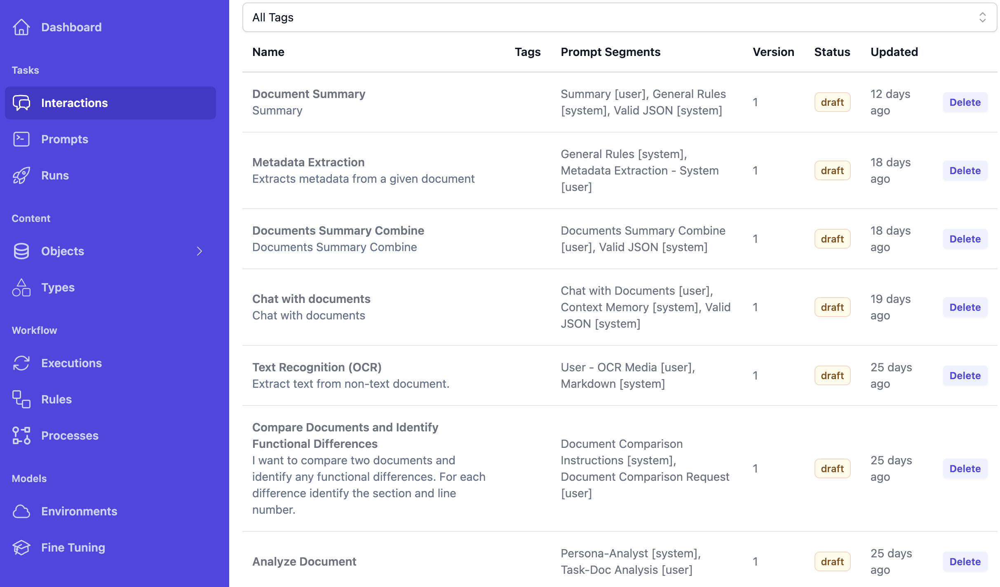

## Maretha.io + Becomposable.com Integration Add-on

### 1.API Key from BeComposable
- https://cloud.becomposable.com/settings#keys
- Create a private secret key with read/execute permissions

### 2.Nuxeo configuration nuxeo.conf
```
cp.auth.token=sk-
cp.api.url=https://api.becomposable.com
cp.upload.url=https://zeno-server-production.api.becomposable.com
cp.supported.mime-types=text/plain,application/pdf,image/jpeg,image/png,image/webp

# dev -> cp.api.url=https://studio-server-preview.api.becomposable.com
```

## 3. Create BeComposable Interactions
### BeComposable Interactions


### BeComposable Interaction Prompts


### BeComposable Prompt


## 4. Nuxeo UI Configuration

### Settings Document
- Admin Settings Page: http://localhost:8080/nuxeo/ui/#!/maretha-cp-interactions
- Settings Document: http://localhost:8080/nuxeo/ui/#!/browse/InteractionSettings

### Interactions Configuration


### Interaction Parameters Configuration


### Interaction Response


## Nuxeo documentation
### Schemas and Facets
```
<schema name="interactionSettings" prefix="interactionsettings" src="data/schemas/interaction-settings.xsd"/>
<schema name="interactionResults" prefix="interactionresults" src="data/schemas/interaction-results.xsd"/>

<facet name="InteractionResultsFacet">
    <schema name="interactionResults" />
</facet>
```