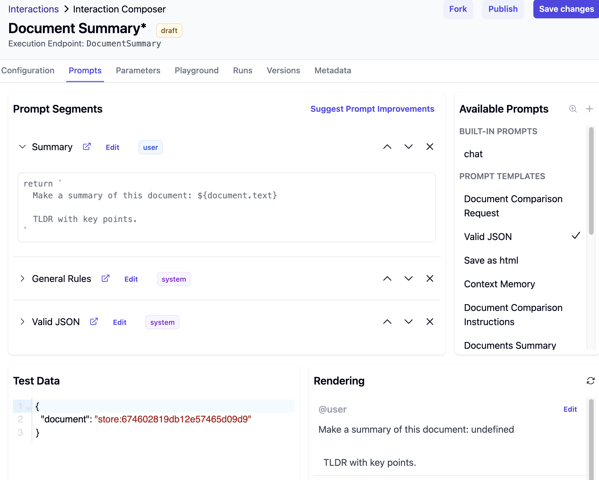
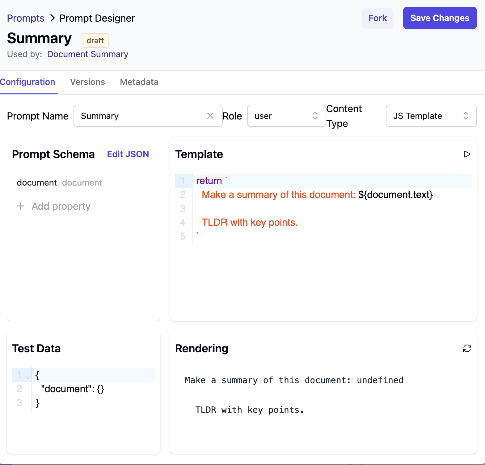
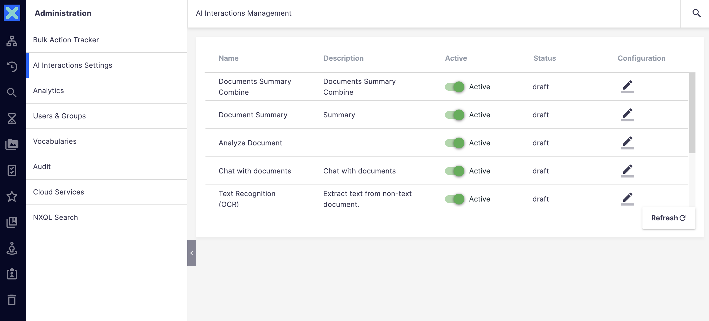
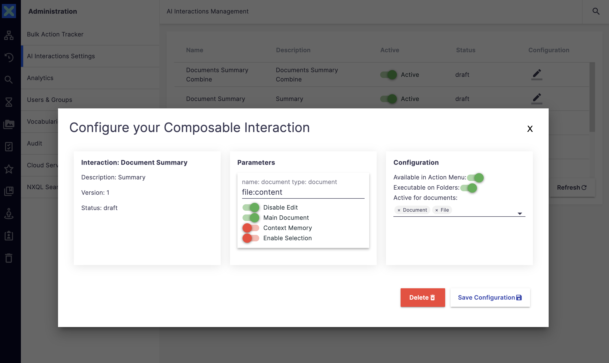
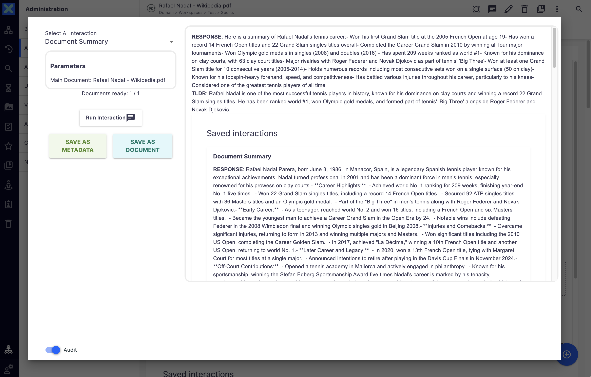

## Maretha.io + Vertesia.com Integration Add-on

### 1.API Key from Vertesia
- https://cloud.vertesia.io/settings#keys
- Create a private secret key with read/execute permissions

### 2.Nuxeo configuration nuxeo.conf
```
cp.auth.token=sk-
cp.api.url=https://studio-server-production.api.vertesia.io/
cp.upload.url=https://zeno-server-production.api.vertesia.io
cp.supported.mime-types=text/plain,application/pdf,image/jpeg,image/png,image/webp
cp.project.id=
cp.environment.id=
cp.embedding.model=text-embedding-3-small

# dev -> cp.api.url=https://studio-server-preview.api.vertesia.io
```

## 3. Create Vertesia Interactions
### Vertesia Interactions


### Vertesia Interaction Prompts


### Vertesia Prompt


## 4. Nuxeo UI Configuration

### Settings Document
- Admin Settings Page: http://localhost:8080/nuxeo/ui/#!/maretha-cp-interactions
- Settings Document: http://localhost:8080/nuxeo/ui/#!/browse/InteractionSettings

### Interactions Configuration


### Interaction Parameters Configuration


### Interaction Response



## Nuxeo documentation
### Schemas and Facets
```
<schema name="interactionSettings" prefix="interactionsettings" src="data/schemas/interaction-settings.xsd"/>
<schema name="interactionResults" prefix="interactionresults" src="data/schemas/interaction-results.xsd"/>

<facet name="InteractionResultsFacet">
    <schema name="interactionResults" />
</facet>
```

## Embeddings search

``` 
<extension target="org.nuxeo.ecm.platform.query.api.PageProviderService" point="providers">
<genericPageProvider name="searchByEmbeddings" class="io.maretha.cp.core.search.CustomKnnSearch">

<queryParameters>
    <parameter name="vectorQuery"/>
    <parameter name="vectorField"/>
</queryParameters>

....            
```

```
public class CustomKnnSearch extends ElasticSearchNxqlPageProvider {
    //...
    final String TEXT_VECTOR_FIELD = "interactionresults:embeddingsText";
    final String IMAGE_VECTOR_FIELD = "interactionresults:embeddingsImage";

    String vectorQuery = namedParameters.get("vectorQuery");
    String vectorField = namedParameters.get("vectorField");
    
    NxQueryBuilder nxQuery = this.getQueryBuilder(session).nxql(query);

    // Combine NXQL and KNN using "must" (AND logic)
    BoolQueryBuilder combinedQuery = QueryBuilders
            .boolQuery()
            .must(getCurrentQueryAsEsBuilder());

    APIService apiService = Framework.getService(APIService.class);
    double[] textVectors = apiService.textToEmbeddings(vectorQuery);
    String vectorJson = Arrays.toString(textVectors);
    String knnJsonQuery = "{\n" +
            "  \"knn\": {\n" +
            "    \"field\": \"" + TEXT_VECTOR_FIELD + "\",\n" +
            "    \"query_vector\": " + vectorJson + ",\n" +
            "    \"k\": " + SEMANTIC_SEARCH_K + ",\n" +
            "    \"num_candidates\": " + numCandidates + "\n" +
            "  }\n" +
            "}";

    QueryBuilder knnTextQuery = QueryBuilders.wrapperQuery(knnJsonQuery);
    combinedQuery = combinedQuery.must(knnTextQuery);

    nxQuery = nxQuery.esQuery(combinedQuery)
            .fetchFromElasticsearch() // Force ES query
            .offset((int) this.getCurrentPageOffset())
            .limit(this.getLimit())
            .addAggregates(this.buildAggregates());

    EsResult ret = esService.queryAndAggregate(nxQuery);
    
}
```

### Settings document
http://localhost:8080/nuxeo/ui/#!/browse/InteractionSettings

### AI models:
```
amazon.titan-embed-image-v1
anthropic.claude-3-5-sonnet
amazon.titan-embed-text-v2
```